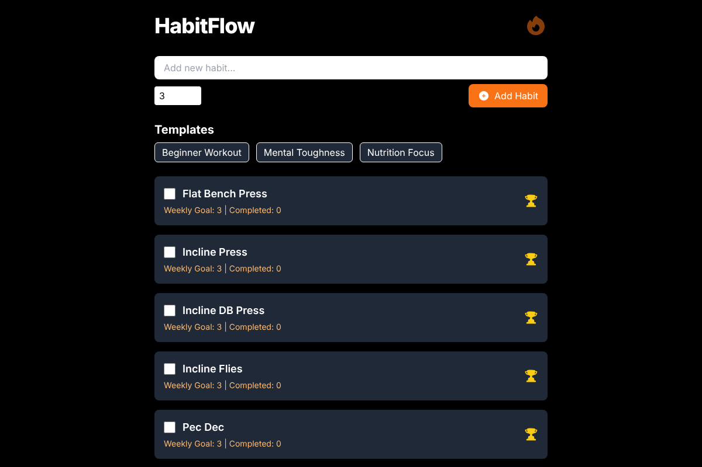

# HabitFlow

A habit tracker for workouts and daily routines, built with React. Add your own habits or start from a template, check them off each day, and see your week in a chart.

**Live demo:** https://habitflow-athletic.vercel.app/



## Tech Stack

- React 18
- Tailwind CSS
- Chart.js with react-chartjs-2
- Heroicons
- Browser localStorage

## Features

- Add habits with a weekly goal
- Check off habits for today
- Start from templates: Beginner Workout, Mental Toughness and Nutrition Focus
- Get a workout plan for each day from Monday to Saturday
- See the last 7 days in a progress chart
- Keep your data in the browser, with no account or backend

## How It Works

The app is a single React component. Habits live in state and are saved to localStorage whenever they change. Each habit stores its completions by date, and the weekly chart reads from those dates.

## Known Issues and Next Steps

- The daily workout plan is added again on every page load, which creates duplicates
- The app only lets you check off today, so past days can't be corrected
- Add a way to delete habits
- Add tests

## Run It

```bash
npm install
npm start
```

Then open http://localhost:3000.
